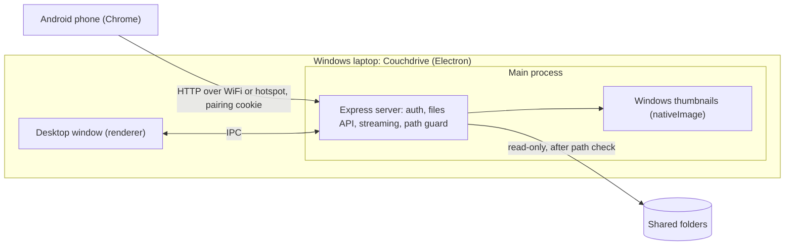

# Couchdrive — Product Requirements Document (v1)

Oct 23, 2026 · @Himanshu Bartwal · Revised after a design review of the Oct 22 draft (working name "LocalShare")

## Overview

Couchdrive turns a Windows laptop into a private local file server, so an Android phone on the same WiFi can browse, stream and download the laptop's files in a browser. No internet, no cable, no WhatsApp round-trip, and nothing to install on the phone.

**Pitch.** Your laptop's files, on your phone. Browse and stream over WiFi; nothing to install on the phone.

**Problem.** To see a PC file on the phone today, people send it to themselves on WhatsApp and download it on the phone, or copy it over a USB cable. Each file takes several steps and minutes. The WhatsApp route also needs internet.

**Solution.** A desktop app shares the folders the user picks and shows a QR code. Scanning it once pairs the phone and opens a mobile web app served by the laptop itself. Videos play instantly with seeking, any file downloads in one tap, and next time the phone reconnects from a bookmark.

**Positioning.** Quick Share and LocalSend already move single files between devices. Couchdrive is for browsing the laptop's folders from the phone and streaming from them without copying anything first.

| Item | v1 decision |
| --- | --- |
| Name | Couchdrive (backup: Lapshelf). "LocalShare" was dropped because several apps already use it, including one on the Microsoft Store |
| Audience | Free public release for anyone with this problem; also the builder's daily tool and a portfolio project |
| Desktop side | Electron app with an embedded Express server running in the main process |
| Phone side | Mobile web app served by the same desktop app; nothing to install |
| Phone platform | Android with Chrome in v1; iPhone is a later bet |
| Network | Same WiFi or the phone's hotspot; no cloud, no internet; plain HTTP on the local network |
| Distribution | Microsoft Store (main channel, signed by Microsoft) plus an installer on GitHub Releases |
| Licence | MIT, public GitHub repo from day one |
| Cost | Free; open-source libraries only |
| Build method | Claude Code (Opus 5.5), using existing libraries over custom code |
| v1 scope | Browse, preview, stream, download, and a tip for sharing files on from the phone |
| Later | Padlock (HTTPS) mode with a real Share button, iPhone, ZIP download; then editing |

## Goals and non-goals

v1 succeeds when any shared PC file can be opened, streamed or downloaded on an Android phone within seconds, with no phone setup beyond one QR scan.

**Goals (v1)**

1. Zero install on the phone: scan a QR code once and the files appear in the browser; the phone stays paired.
2. Works fully offline over the local network, with no cloud server and no account.
3. Video and audio stream with seeking, without downloading the whole file first.
4. One-tap download for every file, and a clear way to share it on from the phone.
5. Private by default: only paired phones can see files, only from folders the user picked, and never anything the user hid in File Explorer.
6. Entirely free to build, run and distribute, using open-source libraries.
7. Trustworthy to install: no Windows or browser warning screens on the main install and connect path.

**Non-goals (v1)**

- Any file editing: rename, delete, new folder, upload from phone, text editing, trimming. Planned for v2 and v3.
- Access from outside the local network (over the internet).
- Cloud sync, backups or user accounts.
- A native Android or iOS app.
- iPhone and Safari support. Planned for later if v1 does well.
- HTTPS and the phone's share menu (Web Share API). Planned as a v1.1 experiment; see Risks.
- Converting video formats the phone browser cannot play (for example some MKV or HEVC files).
- Two-way sync between phone and PC.

## Users and use cases

The first user is the builder, and v1 ships publicly for anyone who keeps videos, documents and audio on a Windows laptop and wants them on an Android phone without WhatsApp or a cable.

| Persona | Situation | What they need |
| --- | --- | --- |
| Laptop-first individual (primary) | Files live on the PC; opens them on the phone several times a day | Fast access to any file, no internet, no rescanning every time |
| Home viewer | Wants to watch a movie or lecture stored on the laptop from bed | Smooth video streaming with seeking |
| Forwarder | Needs to send a PC document or photo to someone on WhatsApp from the phone | Download on the phone, then share from the download notification (direct Share button in v1.1) |
| Student | Notes, PDFs and recorded lectures on the laptop; studies on the phone | Quick PDF preview and audio playback |

**User stories**

1. As a user, I pick the folders to share once, so the rest of my PC stays private.
2. As a user, I scan one QR code the first time and see my files on the phone; after that I open my bookmark and I'm in.
3. As a user, I tap a video and it starts playing in seconds, and I can jump ahead.
4. As a user, I tap Download and the file lands in my phone's storage.
5. As a user, after downloading a file I can send it to WhatsApp, Telegram or email from the phone's download notification.
6. As a user, I search by file name, so I find a file without browsing every folder.
7. As a user, I press Stop on the laptop and the link stops working at once.
8. As a user, I can see which phones are paired and forget any of them.
9. As a user, I close the window and sharing keeps running from the system tray.

## Functional requirements (v1)

v1 ships every P0 item; P1 items ship if time allows; P2 items move to the next release if needed. P0 = must have, P1 = should have, P2 = nice to have.

**Desktop app**

| ID | Requirement | Priority |
| --- | --- | --- |
| D1 | Pick one or more folders to share; add or remove folders any time | P0 |
| D2 | Start and stop sharing with one button | P0 |
| D3 | Detect the laptop's WiFi (LAN) IP address automatically | P0 |
| D4 | Show a QR code plus the plain URL, with a Copy button | P0 |
| D5 | Generate a new random pairing token every time sharing starts; scanning it pairs the phone | P0 |
| D6 | Show sharing status: running or stopped, IP, port, and whether Windows marks the network Private or Public | P0 |
| D7 | Use the same default port every launch, and fall back to the next free port only if it is busy | P0 |
| D8 | Remember shared folders, paired phones and settings between launches | P0 |
| D9 | List paired phones, with Forget for one phone and Forget all | P0 |
| D10 | Warn while sharing on a network Windows marks Public | P0 |
| D11 | Let the user pick the network adapter when there are several (WiFi, Ethernet, VPN) | P1 |
| D12 | Show recent activity (file opened, downloaded) | P1 |
| D13 | Keep the laptop awake while sharing (optional toggle) | P1 |
| D14 | Run in the system tray and keep sharing when the window is closed | P1 |
| D15 | Settings "Open at Windows sign-in" and "Start sharing when the app opens", both off by default; never auto-start sharing on a Public network | P1 |
| D16 | Troubleshooting screen: firewall, Public network, router client isolation, phone-hotspot tip | P1 |

The fixed PIN from the first draft is dropped; pairing replaces it.

**Phone web app**

| ID | Requirement | Priority |
| --- | --- | --- |
| M1 | Home screen lists the shared folders | P0 |
| M2 | Browse into folders, with breadcrumbs and a back button | P0 |
| M3 | Each file shows name, size, modified date and a type icon; OneDrive cloud-only files get a cloud badge | P0 |
| M4 | Play video and audio in the browser with seeking (HTTP range requests); "Can't play in the browser" fallback with Download | P0 |
| M5 | Download button on every file | P0 |
| M6 | One-time tip after the first download: "To send it on WhatsApp, tap the download notification, then Share" | P0 |
| M7 | Friendly screens for wrong or expired link, forgotten phone, and sharing stopped (shown within 5 s) | P0 |
| M8 | Thumbnails for images and videos (Windows' own thumbnails) and a full-screen image viewer with swipe | P1 |
| M9 | PDF and text file preview in the browser | P1 |
| M10 | Search files by name across shared folders | P1 |
| M11 | Sort by name, date or size; list and grid view | P1 |
| M12 | Dark mode that follows the phone's setting | P2 |
| M13 | Add to home screen as a shortcut (web app manifest; on plain HTTP this is a shortcut, not an offline app) | P2 |

Multi-file ZIP download moves to v1.1.

## End-to-end user flow

The phone side needs one QR scan the first time and a bookmark after that.

1. **Install.** The user installs Couchdrive from the Microsoft Store (or the GitHub installer). The installer adds a Windows Firewall rule, so there is no firewall prompt on first run.
2. **Pick folders.** On first launch, the user picks folders to share, for example Videos and Documents. Everything else on the PC stays hidden.
3. **Start sharing.** The user presses Start. The app starts the Express server on the laptop's WiFi IP (for example 192.168.1.5) and its fixed default port.
4. **Token.** The app creates a random pairing token for this sharing session and adds it to the URL. Without it, nobody else on the WiFi can open the files.
5. **QR code.** The laptop screen shows a QR code holding the IP, port and token, plus the same URL as text.
6. **Pair.** The phone, on the same WiFi or hotspot, scans the QR code. The browser opens the web app, which is served by the laptop, not the internet. The token is swapped for a pairing cookie, the token is removed from the address bar, and the user can bookmark the page.
7. **Browse.** The phone asks the server for the folder contents. The server returns names, sizes, dates and types, and the phone shows them as a list.
8. **Play.** Tapping a video or audio file plays it in the browser. The server sends it in pieces (range requests), so it starts at once and seeking works.
9. **Download and share on.** Download saves the full file to the phone. The first time, a tip explains how to send it to WhatsApp, Telegram or email from the download notification.
10. **Come back later.** The bookmark works whenever the laptop is sharing on the same IP and port. If the laptop's IP changes, the user scans the new QR code.
11. **Stop.** The user presses Stop or quits the app. The server shuts down, open connections are dropped, and the link stops working.

## System architecture

Couchdrive is one Electron app with three parts: a desktop window, a local Express server in the main process, and a phone web app that the server itself sends to the phone.



The phone talks only to the laptop over the local network, and the server reads only from the shared folders, after a path check. The server runs in Electron's main process because the Windows thumbnail API is only available there; file reads are asynchronous, so the window stays responsive.

**How streaming works.** When the phone plays a video, the browser asks for one byte range at a time. The server replies with 206 Partial Content and only that piece. Seeking asks for a new range, so playback jumps ahead without downloading the rest. Express's `res.sendFile` does this out of the box.

**Download and share.** Download sends the same file with `Content-Disposition: attachment`, so the phone saves it. v1 has no Share button: the phone's share menu (Web Share API) only works on HTTPS pages, and v1 runs on plain HTTP. Users share from the download notification instead, and padlock mode in v1.1 tests whether a real Share button is possible.

**Project structure**

```
couchdrive/
├── electron/   main process: window, tray, folders, IP, QR, server start and stop
├── server/     Express app: pairing, files API, streaming, path guard, thumbnails
├── web/        phone UI (Preact + Vite), built into server/public
├── shared/     types and constants used by all parts
└── tests/      server unit tests, Playwright phone tests
```

## API specification

v1 is read-only: every endpoint is a GET, and none can change a file on the PC. All `/api/*` routes require a valid pairing cookie; otherwise they return 401.

| Method + path | Purpose | Key parameters | Response |
| --- | --- | --- | --- |
| `GET /?t=<token>` | Open the web app; swaps the token for an HttpOnly pairing cookie, then redirects to `/` without the token | `t` = pairing token | HTML app shell |
| `GET /api/info` | Server name, app version, session status; the phone also polls it to notice Stop within 5 s | none | JSON |
| `GET /api/roots` | List the shared folders | none | JSON array of `{id, name}` |
| `GET /api/list` | List one folder's contents | `root` = folder id, `path` = relative path, `sort`, `offset`, `limit` | JSON: entries + total count |
| `GET /api/search` | Find files by name across shared folders | `q` = text, `limit` | JSON array of entries |
| `GET /api/file` | Stream a file inline for play or preview; supports `Range` | `root`, `path` | Bytes; 206 Partial Content for ranges |
| `GET /api/download` | Download the full file as an attachment | `root`, `path` | Bytes with `Content-Disposition: attachment` |
| `GET /api/thumb` | Windows thumbnail for image and video files (P1) | `root`, `path`, `w` = width | JPEG |

A folder entry looks like this:

```json
{
  "name": "Lecture 04.mp4",
  "path": "Courses/Lecture 04.mp4",
  "type": "file",
  "kind": "video",
  "mime": "video/mp4",
  "size": 734003200,
  "modified": "2026-10-20T18:42:00Z",
  "cloudOnly": false
}
```

Paths are always relative to a shared root and identified by root id, so the phone never sees or sends a full PC path like `C:\Users\...`. Root ids are derived from the folder path, so bookmarks to deep folders survive restarts. File names are sent as UTF-8, and downloads use RFC 5987 encoding so Hindi and other non-English names survive.

## Security and privacy

The rule is simple: only phones paired by scanning the QR code, on the local network, can read only the folders the user picked, minus anything hidden in File Explorer, and nothing can be changed.

| Threat | Control in v1 |
| --- | --- |
| Someone else on the same WiFi opens the server | Random 128-bit pairing token per sharing session in the QR URL; swapped for an HttpOnly, SameSite=Strict pairing cookie; every API call checks it |
| A paired phone is lost or no longer trusted | The laptop lists paired phones with Forget and Forget all; a pairing expires after 30 days without use |
| Guessing the token | Rate-limit failed attempts per IP; lock that IP out for a few minutes after repeated failures |
| Reaching files outside shared folders | Resolve the real path on disk and reject anything that does not sit inside a shared root. Unit tests cover `../`, absolute paths, drive-relative paths (`C:foo`), UNC paths, junctions and symlinks, alternate data streams (`::$DATA`), 8.3 short names (`PROGRA~1`), trailing dots and spaces, and device names (`CON`, `NUL`) |
| Hidden and system files exposed | Hide dot-files, `desktop.ini`, `Thumbs.db`, `$RECYCLE.BIN`, `System Volume Information`, `~$` Office temp files, and anything Windows marks Hidden or System. Node cannot read these attributes, so the server asks Windows once per folder listing and once per root for search |
| Access from the internet | Accept connections only from private LAN address ranges; never open router ports; no cloud relay |
| Public networks | The firewall rule covers Private and Public networks, because Windows marks every new network (including a phone hotspot) Public. The app warns while sharing on a Public network and never auto-starts sharing there |
| Old links still working | A new pairing token every time sharing starts; Stop closes the server and drops open connections immediately |
| Files changed or deleted from the phone | No write endpoints in v1 |
| Tracking | No analytics or telemetry; nothing leaves the local network |

**Known limit.** v1 uses plain HTTP on the local network. Someone on the same WiFi with network-sniffing tools could see the traffic and copy the pairing cookie, then browse the shared folders while sharing is on. That is acceptable for home WiFi and a phone hotspot; Chrome itself treats local IP addresses as lower risk and does not warn about plain HTTP there. The 30-day expiry, Forget, and the Public-network warning limit the damage. Padlock mode (HTTPS) in v1.1 is the real fix.

## Non-functional requirements

The targets below are starting goals for home WiFi; measure them in testing and adjust.

| Area | Requirement | Target |
| --- | --- | --- |
| Speed | QR scan to first folder list on screen | Under 3 s |
| Speed | Tap to first frame for an MP4 video | Under 2 s |
| Speed | Seek to a new point in a video | Under 1 s |
| Speed | List a folder with 5,000 files | Under 1 s, with paged or virtual scrolling |
| Speed | Search across shared folders (up to about 50,000 files) | Results within a few seconds, with a result cap and a timeout; no index |
| Capacity | Phones connected at the same time | At least 3 |
| Capacity | Largest file that streams and downloads | No limit in the app (tested with files over 4 GB) |
| Reliability | Interrupted download | Can resume, since the server supports range requests |
| Reliability | Desktop app crash or quit | Server stops cleanly; no orphan process holds the port |
| Footprint | Desktop app memory when idle | Under 250 MB |
| Install | First run | No Windows Firewall prompt; no SmartScreen warning when installed from the Microsoft Store |
| Compatibility | Desktop OS | Windows 10 and 11 first; macOS and Linux builds from the same code later |
| Compatibility | Phone browsers | Chrome on Android, current version; iPhone Safari later |
| Usability | Phone screens | Usable one-handed on a 360 px wide screen; tap targets at least 44 px |
| Offline | Network need | Works on a router or phone hotspot with no internet connection |
| Cost | Licences, hosting and distribution | Zero; open-source libraries only, no servers to pay for, free Microsoft Store individual account |

## Tech stack

Everything is JavaScript or TypeScript, so one language covers the desktop app, the server and the phone UI, and Claude Code can work across all of it. Every library below is free and open source (MIT or Apache-2.0).

| Layer | Choice | Why |
| --- | --- | --- |
| Language | TypeScript on Node.js | One language end to end; types catch mistakes early |
| Desktop shell | Electron | Desktop app with Node.js built in |
| Local server | Express, in the Electron main process | Simple, well known; `res.sendFile` already handles range requests for streaming |
| QR code | `qrcode` (npm) | Generates the QR image from the URL |
| Settings storage | `electron-store` | Saves shared folders, paired phones and preferences on disk |
| Thumbnails | Electron `nativeImage.createThumbnailFromPath` | File Explorer's own thumbnails for images, videos and PDFs; no native module to package (replaces `sharp`) |
| Hidden and cloud-only detection | Windows' built-in `dir` attribute filters | Node cannot read Windows file attributes; avoids a native module |
| Phone UI | Preact + Vite | Small, fast bundle that loads quickly over WiFi |
| PDF preview | PDF.js | Android Chrome does not show PDFs inline, so the app renders them itself |
| Video and audio | Browser's built-in `<video>` and `<audio>` | No extra library; plays MP4, WebM, MP3, AAC |
| Installers | electron-builder: MSIX for the Microsoft Store, NSIS for GitHub Releases | One config builds both |
| Updates | Microsoft Store updates; `electron-updater` with GitHub Releases for the NSIS build | Free in both channels |
| Testing | Vitest + Playwright | Unit tests for the server; browser tests for the phone UI |

**Reuse versus build.** Libraries and Windows handle the hard parts: streaming, QR, thumbnails, PDF rendering and packaging. The custom code is the glue: folder management, pairing and session logic, path safety checks, attribute checks, and the phone UI.

## UI and UX

The desktop app needs three screens plus a tray menu, and the phone app six screens; the QR code is the centre of the desktop experience.

**Desktop screens**

| Screen | What it shows | Main actions |
| --- | --- | --- |
| Folders (first run and settings) | List of shared folders with name and path; unavailable folders marked | Add folder, remove folder, Start sharing |
| Sharing | Large QR code, URL with Copy, status (running, IP, port, Private or Public network), Public-network warning, paired phones, recent activity | Stop sharing, Forget a phone, Forget all, change network adapter, keep-awake toggle |
| Troubleshooting | Plain-word checks: same WiFi, firewall, Public network, router client isolation, phone-hotspot tip | Retry, open Windows network settings |
| Tray menu | Sharing state | Start or stop sharing, open window, quit |

Settings hold "Open at Windows sign-in" and "Start sharing when the app opens", both off by default.

**Phone screens**

| Screen | What it shows | Main actions |
| --- | --- | --- |
| Home | Shared folders as large tiles, search bar on top | Open folder, search |
| Folder | Breadcrumbs, files and subfolders with icon or thumbnail, name, size, date, cloud badge | Open, sort, switch list or grid, Download per file (via a three-dot menu) |
| Video and audio player | Full-width player with seek bar, file name, size | Play, seek, full screen, Download |
| Image viewer | Full-screen image, swipe to next or previous | Download, close |
| Document viewer | PDF pages or plain text | Scroll, zoom, Download |
| Error states | Wrong or expired link, forgotten phone, sharing stopped, file unplayable in browser, file only in OneDrive | Scan again, Retry, Download instead |

The one-time share tip appears as a small sheet after the first download.

**Design principles**

- Mobile first: one column, large tap targets, the main action reachable with the thumb.
- Bilingual-ready: keep all UI words in one strings file so Hindi can be added later.
- Clear system states: always show whether the phone is connected and what went wrong in plain words.
- Light and dark themes that follow the device setting.

## Edge cases and error handling

Most real-world failures are network problems, not code bugs, so the app must explain them in plain words.

| Case | Expected behaviour |
| --- | --- |
| Phone on a different WiFi or on mobile data | Page does not load; the desktop app shows "Connect your phone to the same WiFi as this laptop" |
| Windows Firewall | The installer adds the rule, so there is no prompt. If the rule is missing (for example in a development build), the troubleshooting screen explains how to allow the app |
| Network marked Public in Windows | Sharing still works; the app shows a warning and never auto-starts sharing there |
| Router blocks devices from talking to each other (client isolation, common on office or hostel WiFi) | Troubleshooting tip: turn on the phone's hotspot and connect the laptop to it |
| Several network adapters (VPN, virtual adapters, Ethernet) | Pick the WiFi adapter by default; let the user choose another; regenerate the QR code |
| Laptop IP changes or the laptop sleeps | The paired phone's bookmark stops working; the app shows a new QR code; keep-awake prevents sleep while sharing; a router DHCP reservation keeps the IP fixed |
| Default port already in use | Use the next free port and update the QR code; paired bookmarks work again once the default port is free |
| Wrong or expired token, or a forgotten phone | Phone shows "This link has expired. Scan the QR code on your laptop." |
| Server stopped while the phone is browsing | Phone shows "Sharing stopped on the laptop" with a Retry button, within 5 s |
| Video format the browser cannot play (some MKV, AVI, HEVC files) | Show "Can't play in the browser" with a Download button |
| Very large file (over 4 GB) | Streams and downloads normally; downloads can resume after a drop |
| File renamed or deleted on the PC while browsing | Show "File not found" and refresh the folder list |
| Folder with thousands of files | Page the list from the server and use virtual scrolling on the phone |
| Hindi or other non-English file names | Display correctly and keep the name when downloaded |
| Folder or file hidden in File Explorer | Never listed, searched or served |
| OneDrive cloud-only file | Cloud badge; opening it makes the laptop download it from OneDrive if it is online, otherwise "This file is only in OneDrive" |
| Phone browser has no share menu on plain HTTP (always in v1) | One-time tip to share from the download notification |
| Shared folder deleted or drive unplugged | Mark it unavailable in the desktop app and hide it on the phone |

## Success metrics and acceptance criteria

v1 is done when every box below is ticked on a real Windows laptop and a real Android phone, and the builder stops using WhatsApp to move files to themselves.

**Success metrics**

| Metric | Target |
| --- | --- |
| Time to open a PC file on the phone, from app launch | Under 15 s (versus minutes with WhatsApp) |
| Files that open, play or download without error | Over 95% of attempts |
| WhatsApp-to-self transfers per week | Close to zero after two weeks of use |
| Setup steps on the phone | One QR scan the first time; none after that |

**Acceptance criteria**

- [ ] Install from the Microsoft Store and from the GitHub installer; both launch without errors and without a firewall prompt
- [ ] Pick two folders; they persist after restarting the app
- [ ] Start sharing shows a QR code and URL with the correct WiFi IP
- [ ] Scanning the QR code on Android Chrome opens the file list, with no Chrome warning page
- [ ] A paired phone still opens from its bookmark after the laptop app restarts; after Forget, it shows the expired screen
- [ ] A 1 GB MP4 starts playing within 2 s and seeking works
- [ ] An MP3 plays, with seeking
- [ ] A video the phone cannot play shows "Can't play in the browser" with a Download button
- [ ] Download saves the file with its original name, including a Hindi file name
- [ ] After the first download the share tip appears, and following it sends the file on WhatsApp
- [ ] A URL without the token, or with a wrong token, gets no files
- [ ] Requests with `../`, absolute paths and the other attack paths listed under Security are rejected
- [ ] A folder hidden in File Explorer never appears on the phone, in folder lists or in search
- [ ] A OneDrive cloud-only file shows a cloud badge; with no internet, opening it says the file is only in OneDrive
- [ ] Sharing works on a network Windows marks Public, and the laptop shows the Public warning
- [ ] Closing the window keeps sharing running from the tray; auto-start never begins sharing on a Public network
- [ ] Stop sharing makes the phone show the stopped screen within 5 s
- [ ] A folder of 5,000 files lists in under 1 s
- [ ] The app works with the phone's hotspot and no internet

## Build plan with Claude Code

Build v1 in five milestones, one at a time, and pass each gate on a real Android phone before starting the next.

| # | Milestone | What gets built | Gate |
| --- | --- | --- | --- |
| 1 | Spike | Electron + TypeScript app, Express server on the WiFi IP, fixed default port with fallback, QR code with token, test page | Opens from the QR code on home WiFi and on the phone's hotspot with no internet. A 1 GB MP4 plays and seeks. Record what Chrome does when downloading mp4, pdf, zip and apk files. A Hindi file name survives download |
| 2 | Safe server core | Shared roots, path guard, hidden/system and OneDrive detection, pairing cookie (30 days, Forget), private-IP filter, rate limit, all `/api` routes, on-demand search | Vitest suite passes, including every Windows attack path listed under Security; no cookie gets 401 |
| 3 | Phone app | Home, folders, virtual list, player with "can't play" fallback, Download plus share tip, error screens with 5 s stop detection, search, sort and grid, thumbnails, image viewer, PDF and text preview, dark mode (if time), strings file | Every phone acceptance criterion passes on Android Chrome; a 5,000-file folder lists in under 1 s |
| 4 | Desktop app | Folders, Sharing and Troubleshooting screens, adapter picker, saved settings, paired phones with Forget, activity, keep-awake, tray, auto-start settings, Public-network warning, unplugged-drive handling | Every desktop acceptance criterion passes; idle memory under 250 MB |
| 5 | Package and release | NSIS installer for GitHub (firewall rule, auto-update), MSIX for the Microsoft Store (firewall rule in the package), README, privacy page, Store submission | Full checklist passes on a clean install from both installers; no leftover process after quitting |

Milestone 1 is a spike on purpose: it answers the download-over-HTTP and hotspot questions before any feature depends on them.

**Working with Claude Code**

1. This PRD lives in the repo as `PRD.md`; open Claude Code in the repo folder.
2. Ask for one milestone per session. Run it, test it on the phone, then commit to Git.
3. Ask for tests with every milestone, especially the path guard, pairing and attribute checks.
4. After each milestone, tick the matching acceptance criteria and update the open questions here.

Starter prompt for milestone 1:

```
Read PRD.md. Build milestone 1 only: an Electron + TypeScript app that starts an
Express server on the laptop's WiFi IP and a fixed default port (next free port if
busy), shows a QR code with the URL and a random token, and serves a test page to
the phone. The test page must play a large MP4 with seeking (range requests) and
offer test downloads (mp4, pdf, zip, apk, and a file with a Hindi name) so I can
record what Chrome on Android does with each. Stop when the gate passes, and tell
me exactly how to test it on my phone, on home WiFi and on my phone's hotspot.
```

## Risks, decisions and roadmap

The biggest risks are network setup on real Windows laptops and a path-check bug; the HTTPS question is deferred to v1.1 by choosing plain HTTP.

**Risks**

| Risk | Impact | Mitigation |
| --- | --- | --- |
| Firewall, Public network setting or router isolation blocks the phone | High | Installer firewall rule for Private and Public networks, Public-network warning, troubleshooting screen, phone-hotspot tip |
| A path-check bug exposes files outside shared folders | High | One central path check; unit tests with every Windows attack path listed under Security |
| Chrome on Android may warn about or block some downloads over plain HTTP (for example zip or apk) | Medium | Measured in milestone 1; explained in the troubleshooting screen; padlock mode in v1.1 |
| Someone sniffing the same WiFi copies the pairing cookie | Medium | 30-day expiry, Forget, Public-network warning; padlock mode in v1.1 |
| Microsoft Store review and MSIX packaging quirks (firewall rule in the package, settings storage inside the package) | Medium | Build an MSIX early in milestone 5; keep the GitHub installer as a fallback |
| The GitHub installer is unsigned and shows "Windows protected your PC" | Medium | The Store is the main channel; apply to SignPath Foundation for free signing once the project has public users |
| Some videos (MKV, HEVC) will not play in the phone browser | Medium | Detect and offer Download; add FFmpeg conversion in a later version |
| OneDrive cloud-only files fail when the laptop is offline | Medium | Cloud badge and a clear message |
| Quick Share, LocalSend, copyparty and HFS already cover parts of this | Medium | Positioning: browse and stream the laptop from the phone, zero install, a polished Windows app |
| Electron makes the app large (around 100 MB or more) | Low | Acceptable for v1; Tauri is an option later |
| Name clash | Low | Couchdrive checked on Oct 23, 2026: no app, Store listing or GitHub repo found. Reserve the name in Microsoft Partner Center when registering |

**Decisions from the design review (Oct 23, 2026)**

- Laptop OS first: Windows only; macOS and Linux later.
- Personal tool, portfolio or public release: a free public release that is also a personal tool and portfolio piece; MIT licence; Microsoft Store plus GitHub Releases.
- Certificate warning for HTTPS: not in v1. v1 uses plain HTTP, so there is no browser warning; padlock mode is a v1.1 experiment.
- Fixed port and PIN, or a new token every session: the phone pairs once and keeps a pairing cookie; the port stays fixed; the QR token still changes every session; the PIN is dropped.
- Final name: Couchdrive.

**Changes after the milestone 1 build (Oct 23, 2026)**

- Padlock mode moved into the milestone 1 spike, at the builder's request. The window offers a padlock link (HTTPS, self-signed certificate) next to the plain HTTP link, and the test page has Share buttons on the padlock link. The certificate is saved and reused, and gets a new one only when the laptop's address isn't on it yet, so Chrome warns once per phone and network. Which link v1 shows by default is decided from the phone results.
- A basic per-user NSIS installer (desktop and Start menu shortcuts) moved forward, so the app opens without a terminal. It is unsigned and adds no firewall rule. Milestone 5 still owns signing, the firewall rule, auto-update and the Store package.

**Open questions**

- [ ] What does Chrome on Android do with plain-HTTP downloads from a local IP, by file type? Answered in milestone 1.
- [ ] Can electron-builder's MSIX build declare the firewall rule inside the package? Answered in milestone 5.
- [ ] With padlock mode (self-signed HTTPS), does Android Chrome open the share menu after the user taps through the warning? Moved into milestone 1; answered by the phone test.

**Roadmap after v1**

| Version | Adds |
| --- | --- |
| v1.1 | Padlock (HTTPS) mode experiment with a real Share button, iPhone Safari, multi-file ZIP download, a typed pairing code if testers ask, remaining P1 and P2 items |
| v2 | Basic editing: rename, delete to Recycle Bin, new folder, upload from phone to PC, edit text files |
| v3 | Media editing on the laptop with FFmpeg: trim audio and video, convert unplayable videos |
| Later | macOS and Linux builds (Linux needs a thumbnail fallback), a native Android app for background transfers, access from outside the home network |
